<h1 align="center">Smart Parking Lot</h1>

<p align="center">
  An ESP32 parking system on a 1:100 physical model: ultrasonic sensing, A* stall allocation with a grace period,
  and a live web dashboard served by the board itself.
</p>

<p align="center">
  
  
  
  
  
  
</p>

<p align="center">
  
</p>

<p align="center">
  <a href="https://github.com/AseelKurdy/smart-parking-lot/releases/tag/v1.0"></a>
</p>

B.Sc. project in Internet of Things (IoT), Technion – Faculty of Computer Science, 2026.
**Authors:** Aseel Kurdy · Nayef Habiballah · Osama Abdulhalim. **Instructors:** Itai Dabran · Ido Ram · Diana Cohen.

**Read first:** the [research document](docs/research_document.pdf) (design, related work, simulation study; the user and programmer manuals are separate files listed below) and the [poster](docs/poster.pdf).

---

## Contents

- [What it does](#what-it-does)
- [Demo](#demo)
- [How it works](#how-it-works)
  - [The physical model](#the-physical-model)
  - [Sensing](#sensing)
  - [Allocation: road network and A*](#allocation-road-network-and-a)
  - [Live web dashboard](#live-web-dashboard)
- [Verification](#verification)
- [Simulation study](#simulation-study)
- [Repository layout](#repository-layout)
- [Getting started](#getting-started)
- [Documents](#documents)
- [Authors and license](#authors-and-license)

---

## What it does

Drivers waste time and fuel circling for a free space. This project builds a parking lot that **tells each arriving car exactly where to go**, and proves the idea on a working scale model:

- **A car arrives.** An ultrasonic sensor across the entrance counts it, once, even if it stops in front of the sensor.
- **The system picks the closest free stall.** The lot is stored as a road network with the lengths measured on the model; A* finds the shortest driving route to every stall at boot, so the choice is instant.
- **The stall is reserved for 60 seconds.** Park in time and the stall turns green; miss the window and it goes back to the next driver; park somewhere else and your original stall is released at once and the wrong one is flagged red.
- **A second sensor above stall 0 confirms real parking**, lights the LED steadily for the right car and blinks it for the wrong one, and marks the stall *blocked* when an object appears with no car on its way.
- **Everyone sees it live.** The ESP32 opens its own Wi-Fi network and serves a 2D/3D dashboard that polls the board every second: stalls, reservations with countdowns, routes, and the measured geometry.

Everything runs on the single ESP32 board; there is no PC in the loop.

## Demo

<p align="center">
  <a href="https://github.com/AseelKurdy/smart-parking-lot/releases/tag/v1.0">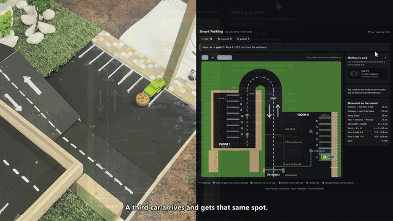</a><br>
  <sub>A driver ignores the system and parks in stall 3: the dashboard turns stall 3 red and releases the reserved stall 1 immediately. Click for the full video.</sub>
</p>

**Full demo video (3 min, narrated):** the model and the live dashboard side by side: a new car gets the nearest stall, parks in time, a reservation expires, and a driver parks in the wrong stall.

- ▶ **[Watch / download `SmartParking_demo.mp4`](https://github.com/AseelKurdy/smart-parking-lot/releases/download/v1.0/SmartParking_demo.mp4)** (112 MB)
- or open the **[v1.0 release page](https://github.com/AseelKurdy/smart-parking-lot/releases/tag/v1.0)**

<p align="center">
  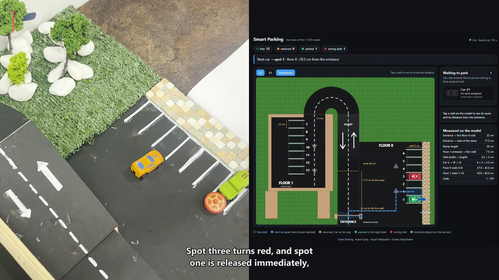
</p>

## How it works

<p align="center">
  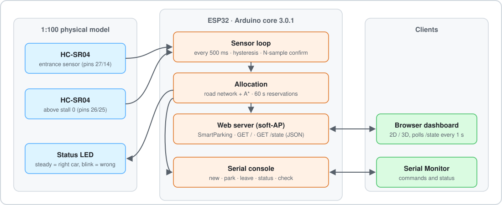
</p>

### The physical model

The model is built at **1:100**, so every centimetre on it is a metre in a real lot, and every number in the firmware is a measurement taken on the model.

| Element | Measured |
|---|---|
| Floors × stalls | 2 × 7 = 14 (stalls 0–6 on floor 0, 7–13 on the raised floor 1) |
| Stall (width × length) | 2.5 × 5 cm  (= a standard 2.5 × 5 m bay) |
| Car (L × W × H) | 4 × 2 × 2.5 cm |
| Entrance → first floor-0 stall | 22 cm |
| Entrance → start of the ramp | 17.5 cm |
| Ramp | 20 cm |
| Floor-1 entrance → first floor-1 stall | 7.5 cm |

Driving distances that A* derives from these (centimetres on the model, metres at full scale):

| Stall | 0 | 1 | 2 | 3 | 4 | 5 | 6 |
|---|---|---|---|---|---|---|---|
| Floor 0 | 27.0 | 29.5 | 32.0 | 34.5 | 37.0 | 39.5 | 42.0 |

| Stall | 7 | 8 | 9 | 10 | 11 | 12 | 13 |
|---|---|---|---|---|---|---|---|
| Floor 1 | 50.0 | 52.5 | 55.0 | 57.5 | 60.0 | 62.5 | 65.0 |

<p align="center">
  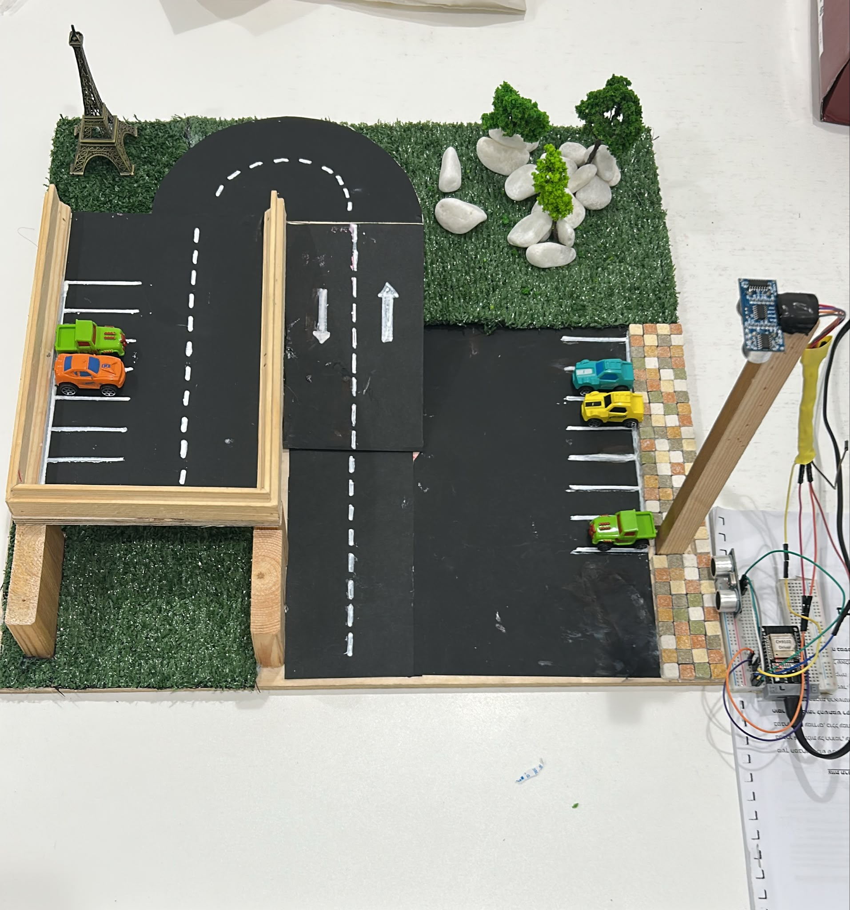
  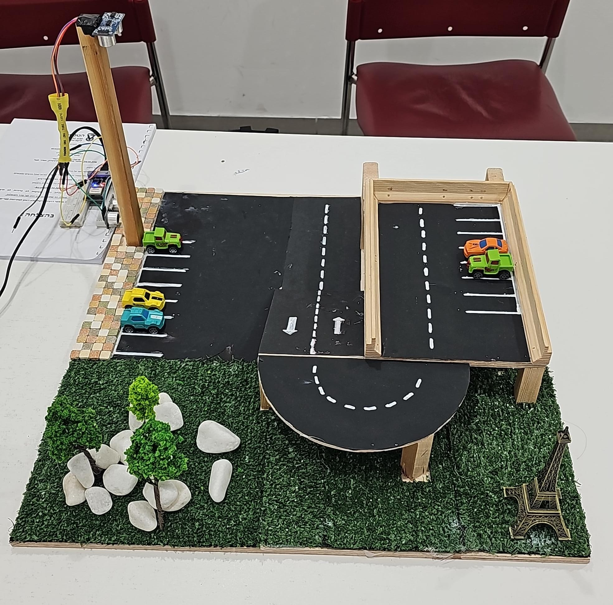
  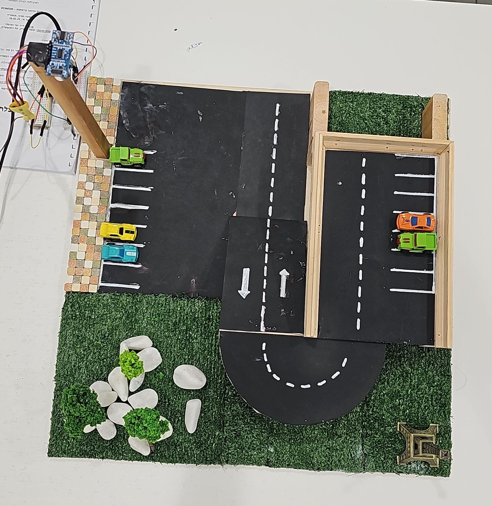
</p>

### Sensing

Two HC-SR04 ultrasonic sensors are read every 500 ms, fired 60 ms apart so one never hears the other's echo. Readings below the sensor's 2 cm minimum are treated as electrical noise and restart the confirmation count.

| Sensor | Reads | Rule |
|---|---|---|
| **Entrance** (sideways across the road, pins 27/14) | wall ≈ 30 cm, passing car ≈ 22 cm | a car is counted below **25 cm** after 2 consecutive readings, and only once until the road reads empty twice |
| **Stall 0** (from above, pins 26/25) | empty 25–26 cm, parked car 22.5–24.5 cm | arrives below **24.7 cm**, leaves above **24.9 cm** (hysteresis), each after 4 consecutive readings (2 s) |

The on-board LED (pin 2) is off while stall 0 is empty, steady when the assigned car is parked there, and blinking when a different car took it.

### Allocation: road network and A*

The lot is a small graph built at boot from the measured lengths, drawn here in the model's real layout. From the entrance one road leads 22 cm to the floor-0 lane; the other climbs the ramp (17.5 cm to its start, 20 cm up and around the U-turn) and enters floor 1, 7.5 cm before its first stall. Neighbouring stalls are one stall width (2.5 cm) apart along their lane, and each stall hangs off its lane point by its length (5 cm): it can only be a destination, never driven through.

<p align="center">
  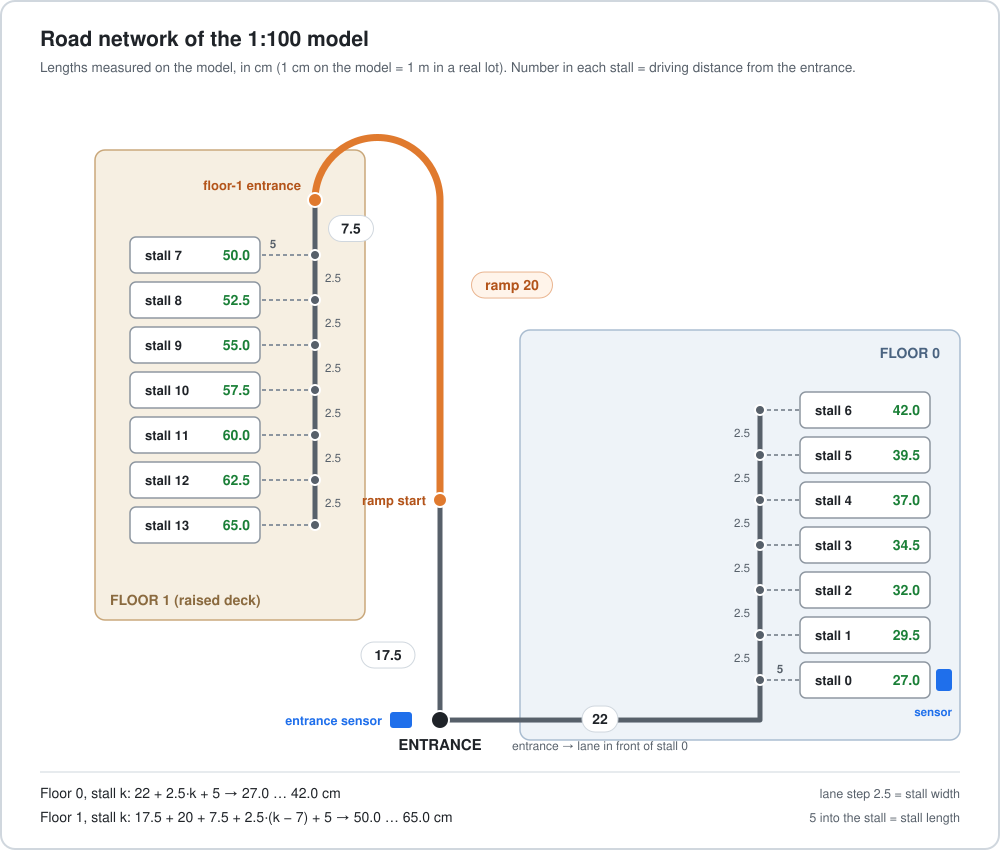
</p>

- **A\*** runs once per stall at boot. The heuristic is the stall length plus, on the goal's own lane, the remaining distance along the lane; it never overestimates, so the result is the true shortest route. Because the lot is fixed, allocation at run time is a lookup.
- A new car gets the nearest stall that is free, not reserved for someone else and not blocked, and a **60-second reservation**.
- Rules for drivers who don't follow instructions: parking in another stall releases your own reservation at once and flags the stall as *wrong*; taking a stall reserved for someone else re-routes that car immediately; a reservation that expires returns the stall to the pool; an object on stall 0 with no car on its way marks it *blocked* so nobody is sent there.

### Live web dashboard

The ESP32 runs as an access point (`SmartParking`, open network). The page at `http://192.168.4.1` is stored in flash and polls `/state` (JSON) every second; nothing else is needed on the phone or laptop.

<p align="center">
  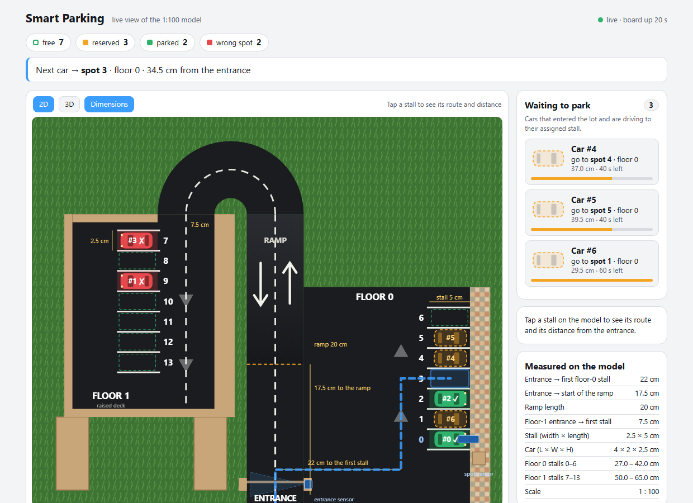
  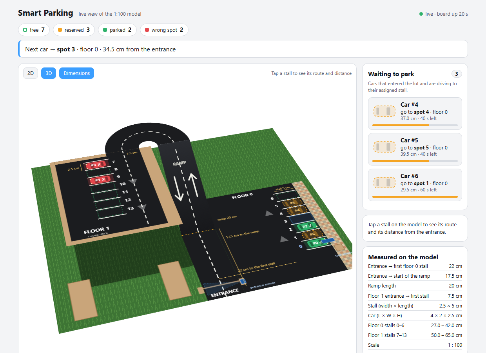
</p>

- 2D, 3D and *Dimensions* views drawn to the measured geometry; tap a stall to see its route and distance.
- Colours: **blue dashed** = where the next car will be sent · **amber** = reserved, car on its way (with the countdown) · **green** = parked correctly · **red** = wrong stall · **grey** = blocked.
- A waiting list of cars that entered but have not parked yet, each with its stall and the seconds left.

A *research* build of the same firmware (`firmware/smart_parking_v9_research`) reports distances in metres of the full-size lot, for the research document and the simulation.

Screenshots of the running system (Wi-Fi, dashboard states, Serial Monitor) are in [`docs/screenshots/`](docs/screenshots).

## Verification

The firmware is tested **without the board**: the unmodified `.ino` is compiled on a PC with small stand-ins for the Arduino core, the two sensors, the LED, the serial port and the web server (`tests/host_sim`). The same suite also drives the real board over USB.

| Check | How | Result |
|---|---|---|
| Automated suite | 38 behaviour tests (parser, allocation, A* distances against an independent formula, timeouts, stress) + 16 sensor/LED/web tests, on the host simulator | **54 / 54 passed** ([log](tests/last_full_run.txt), [report](tests/report.md)) |
| Model-based fuzzing | an independent Python model of the rules replays random operations and compares the firmware state after every one | **161,040 operations, 0 divergences** |
| Edge cases | 3-digit car ids, more than 16 waiting cars, worst-case payload size | 13 / 13 |
| Compile for the target | the sketch compiled with the real Xtensa toolchain and the real core 3.0.1 headers | OK, no warnings (both sketches) |
| Dashboard | the page's JavaScript fed 1,029 real `/state` payloads in a browser and its DOM compared with the data | 0 mismatches |
| On the board | the 38-test suite over USB on the ESP32 | 38 / 38 |
| Test the tests | 16 bugs planted on purpose | all 16 caught |

Details and how to run everything: [`tests/README.md`](tests/README.md).

## Simulation study

`simulation/` is an independent Python model used in the [research document](docs/research_document.pdf) to estimate what guided allocation saves in a real lot. It compares an assigned driver with a driver searching alone (who notices every free stall, or only half of them) and with random search, over 20 replications of 3,000 cars per setting, on the 14-stall demo lot and on a 216-stall, three-floor garage; parameters and their sources are in `simulation/params.py`.

Headline (garage, 85 % occupancy, versus a driver who sees every free stall): about **85 m and 31 s saved per car**; for the ≈ 548,000 cars such a garage serves in a year that is ≈ 4,700 driver-hours, ≈ 4,700 litres of fuel and ≈ 11 t of CO₂. In the single-lane demo lot the searching driver drives the same route as the assigned one, so savings appear there only when drivers miss free stalls.

<p align="center">
  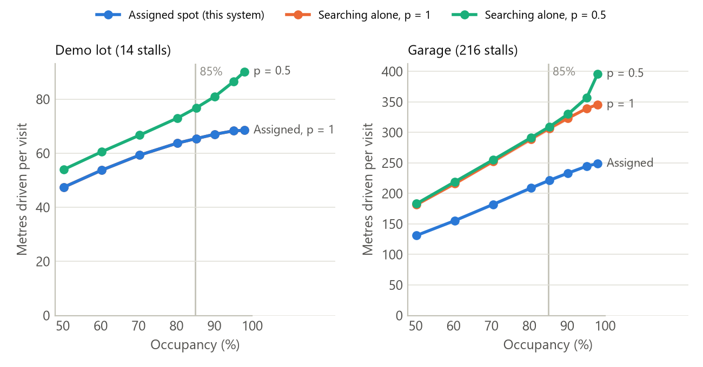
  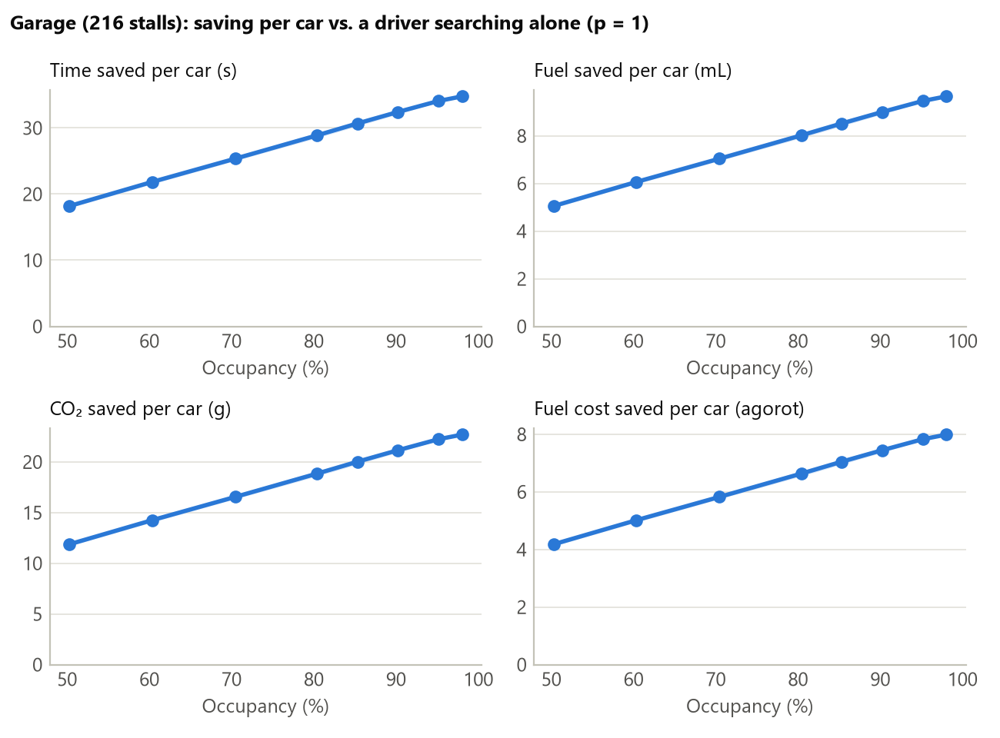
</p>

## Repository layout

```
smart-parking-lot/
├── firmware/
│   ├── smart_parking_v9/           the sketch that runs on the model (.ino + the web page in parking_page.h)
│   ├── smart_parking_v9_research/  the same firmware reporting metres instead of centimetres
│   └── README.md                   wiring, build settings, where the constants live, calibration
├── tests/
│   ├── run_tests.ps1               the 54-test suite (host simulator or real board)
│   ├── host_sim/                   the real .ino compiled on a PC with Arduino/WiFi/WebServer stand-ins
│   ├── fuzz_model.py               model-based fuzzing against an independent Python model
│   ├── edge_cases.py               edge-case checks
│   ├── esp32_syntax_check.ps1      compile with the real ESP32 toolchain
│   ├── last_full_run.txt           log of the last complete run (54/54)
│   └── README.md
├── simulation/                     Python study behind the research document (lot model, A*, experiments, figures, results)
├── docs/                           research document, project documentation, user and programmer manuals, poster (PDF),
│                                   screenshots of the running system
├── media/                          photos of the model, demo GIF and still
├── LICENSE                         MIT
└── README.md
```

## Getting started

### Hardware

| Part | Notes |
|---|---|
| ESP32 development board (ESP32 Dev Module) | one |
| HC-SR04 ultrasonic sensors | two: one across the entrance, one above stall 0 |
| Status LED | the on-board LED on GPIO 2 |
| Wiring | entrance Trig 27 / Echo 14, stall-0 Trig 26 / Echo 25 (a divider on each 5 V Echo line is recommended) |

### Flash the firmware

1. Arduino IDE 2.x → Boards Manager → install **esp32** by Espressif, version **3.0.1**.
2. Open `firmware/smart_parking_v9/smart_parking_v9.ino`, select *ESP32 Dev Module*, upload.
3. Serial Monitor at **9600 baud**, line ending *New Line*. The boot banner prints the 14 distances and the sensor thresholds.

### Use it

- Join the Wi-Fi network **SmartParking** (no password) and open **http://192.168.4.1**.
- Or drive it from the Serial Monitor:

| Command | Effect |
|---|---|
| `new` | a car enters and gets the nearest free stall (what the entrance sensor does automatically) |
| `park <stall> <car>` | report that a car parked (stall 0 reports itself through its sensor) |
| `leave <car>` / `cancel <car>` | the car leaves the lot |
| `status` | state of every stall and the waiting list |
| `check [seconds]` | raw sensor readings, for calibration |
| `help` | the list of commands |

### Run the tests (Windows)

Requirements: PowerShell 5+, a `g++` on the PATH (MinGW-w64 / TDM-GCC), Python 3.8+.

```powershell
cd tests
powershell -File run_tests.ps1 -Sim          # builds the host simulator, runs the 54 tests, writes report.md
python fuzz_model.py --seeds 200 --ops 800   # model-based fuzzing
python edge_cases.py
powershell -File esp32_syntax_check.ps1      # needs the Arduino esp32 core 3.0.1 installed
powershell -File run_tests.ps1 -Port COM10   # the same suite against the real board (set TEXT_MAP = true first)
```

### Run the simulation

```powershell
cd simulation
pip install numpy pandas matplotlib
python test_sim.py             # 11 checks, a few seconds
python run_all.py              # about 3 minutes; writes results/*.csv and figures/*.png
```

Checked on Python 3.12: all 11 tests pass and `run_all.py` reproduces the files in `results/` exactly (fixed random seeds). The full user and programmer guides of the simulation are Appendices A and B of the research document.

## Documents

| Document | Language | File |
|---|---|---|
| **Research document** (stage 3): general description, introduction, related work, project description, simulation, conclusions; appendices: simulation user and programmer guides | English | [`docs/research_document.pdf`](docs/research_document.pdf) |
| Poster | English | [`docs/poster.pdf`](docs/poster.pdf) |
| Project documentation (design, measurements, calibration, tests) | Hebrew | [`docs/project_documentation.pdf`](docs/project_documentation.pdf) |
| User manual | Hebrew | [`docs/user_manual.pdf`](docs/user_manual.pdf) |
| Programmer manual (firmware structure, JSON schema, page functions) | English | [`docs/programmer_manual.pdf`](docs/programmer_manual.pdf) |
| Screenshots of the running system | — | [`docs/screenshots/`](docs/screenshots) |

## Authors and license

**Aseel Kurdy · Nayef Habiballah · Osama Abdulhalim** — B.Sc. project in Internet of Things (IoT), Technion – Faculty of Computer Science, 2026. Instructors: Itai Dabran, Ido Ram, Diana Cohen.

Released under the [MIT License](LICENSE).
